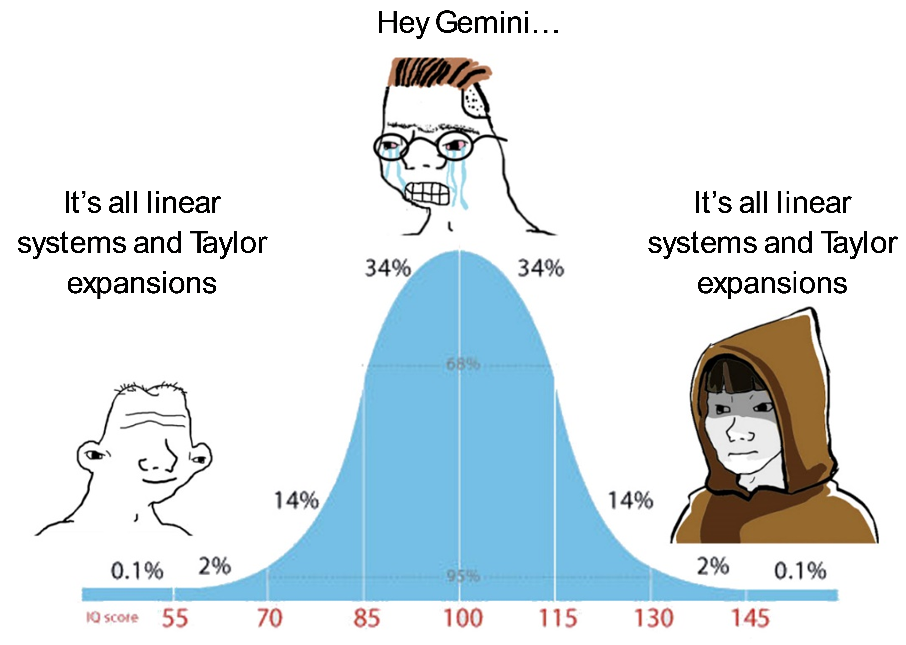

# Welcome to Executable Engineering - Interactive Numerical Methods in Python

```{image} images/exe_logo.png
:width: 60%
:align: center
```

The core philosphy of this text it to experience first-hand the use of numerical methods to solve mathematical problems. Herein, we'll explore how complex problems are decomposed into simpler, easier problems that can be solved algorithmically. We will discuss the fundametal principles used in modern open-source tools and how these tools can be leveraged efficiently and effectively.


**NB:** This book is designed to be interactive in-browser. However, this technology is evolving and not always stable. While execution of the cells appears robust, editing is temperamental. As a fallback, a Google Colab link is provided for each notebook which will launch a fully interactive Python environment.

## Tools and Resources

* [PDF of the full book](https://github.com/themintlab/ExecutableEngineering/releases/download/latest/book.pdf)
* [Youtube channel with lectures](https://www.youtube.com/@McMaster_EngPhys3NM4)
* [Virtual Tutor](https://notebook.google.com/notebook/e1933866-a509-4c2a-b6f2-b627a9b76b05)
* [Associated PyPI Package](https://pypi.org/project/executable-engineering/)

This resource is being developed in part through the [McMaster University Open Educational Resources grant](https://mi.mcmaster.ca/oer-grant).

## A bit of fun


